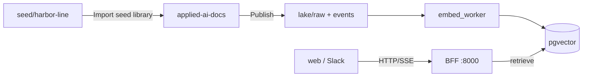

# Applied AI Platform & MCP Workflow Engine

[](https://github.com/bernardovchevez/applied-ai-platform/actions/workflows/ci.yml)

End-to-end applied AI reference platform for media operations, rights clearance, and production workflows. Combines multi-backend RAG (`pgvector`, `Chroma`, `Pinecone`, hybrid BM25 + vector), a multi-agent LangGraph + **Model Context Protocol (MCP)** workflow service with deterministic guardrails and human-in-the-loop approval gates, and a FastAPI presentation BFF with `Langfuse` tracing and `MLflow` evaluation tracking.

| Module | Directory | Focus |
|-------|-----------|-------|
| **1. Enterprise Doc Q&A & Evals** | `rag/` | Multi-backend RAG (`pgvector`, `Chroma`, `Pinecone`, hybrid BM25 + vector) + 23-question gold eval & RAGAS harnesses |
| **2. Multi-Agent & MCP Workflows** | `agents/` | LangGraph supervisor + ReAct sub-agents, custom MCP server (`stdio` / `SSE`), deterministic grounding & escalation guards |
| **3. AI Platform, Data Plane & Ops** | `platform/` | FastAPI OpenAPI BFF, batch + event-driven lake ingest, PEFT/LoRA classifier, `Langfuse` tracing, `MLflow` eval tracking |

Companion clients (consume the FastAPI BFF over HTTP/SSE):

| GitHub repository | `X-Client-Platform` | Surface |
|-------------------|---------------------|---------|
| [applied-ai-web](https://github.com/bernardovchevez/applied-ai-web) | `web` | Next.js chat, agent workflow, eval admin |
| [applied-ai-slack](https://github.com/bernardovchevez/applied-ai-slack) | `slack` | `/media-ask`, `/media-clearance`, `/media-status`, `@media-ops`, Block Kit approvals |
| [applied-ai-docs](https://github.com/bernardovchevez/applied-ai-docs) | (catalog) | SharePoint-style document library; **publish** → lake raw → pgvector index |

**Document SoT:** [applied-ai-docs](https://github.com/bernardovchevez/applied-ai-docs) owns content and metadata; this repo owns the **index and AI APIs** after publish. See [docs/document-corpus-sources.md](docs/document-corpus-sources.md).

### Golden path (localhost)

Canonical flow for demos and day-to-day edits. RAG experiments under `rag/` may ingest Chroma/Pinecone directly; **production-shaped** Q&A uses **pgvector** fed by publish + embed worker.



Step-by-step: [applied-ai-docs/docs/localhost-setup.md](https://github.com/bernardovchevez/applied-ai-docs/blob/main/docs/localhost-setup.md).

Localhost demo prompts (Slack and equivalent web questions): [applied-ai-slack/docs/local-slack-testing.md#sample-prompts-for-localhost-demos](https://github.com/bernardovchevez/applied-ai-slack/blob/main/docs/local-slack-testing.md#sample-prompts-for-localhost-demos).

## Quick start

```bash
cd applied-ai-platform
python3.12 -m venv .venv
source .venv/bin/activate
pip install -r requirements.txt
cp .env.example .env   # add API keys and/or use Ollama
python guardrails/provider_compare.py
```

### Local Ollama (zero API billing)

```bash
brew install ollama
ollama serve                    # or open the Ollama app
ollama pull llama3.2            # chat
ollama pull nomic-embed-text    # RAG embeddings
```

Add to `.env` to prefer Ollama over OpenAI:

```env
LLM_PROVIDER=ollama
EMBEDDING_PROVIDER=ollama
```

```bash
python guardrails/provider_compare.py --preset summarize --providers ollama
python rag/ingest.py
python rag/query.py "Is the theme song cleared for EMEA streaming?"
```

## Postgres + pgvector

```bash
docker compose up -d
python rag/ingest_pgvector.py
python rag/query_pgvector.py "Is the theme song cleared for EMEA streaming?"
python rag/query_pgvector.py "EMEA music clearance" --sql-demo
python rag/query_pgvector.py "..." --doc-type rights_clearance --rights-tier cleared
```

## Optional: Pinecone

Set `PINECONE_API_KEY` in `.env`, then:

```bash
python rag/ingest_pinecone.py
python rag/query_pinecone.py "Is the theme song cleared for EMEA streaming?"
python rag/query_pinecone.py "EMEA music clearance" --filter-demo
python rag/query_pinecone.py "..." --doc-type rights_clearance --rights-tier cleared
```

## Hybrid BM25 + vector

Requires Chroma ingest (`python rag/ingest.py`). BM25 index is built in-memory from corpus.

```bash
python rag/query_hybrid.py "Riverdale Docs Q3 sponsorship" --show-context
python rag/evals/run_eval.py --backend hybrid
```

## Data plane & incremental ingest

Published corpus lives in `data/lake/raw/` (from **applied-ai-docs** publish). See [docs/document-corpus-sources.md](docs/document-corpus-sources.md) and [docs/data-plane.md](docs/data-plane.md):

```bash
pip install -r requirements-pipelines.txt
python platform/pipelines/ingest_batch.py --emit-events
python platform/pipelines/embed_worker.py
python rag/ingest_pgvector.py --data-dir data/lake/raw
```

Seed library: [applied-ai-docs/seed/harbor-line](https://github.com/bernardovchevez/applied-ai-docs/tree/main/seed/harbor-line). **Clean localhost:** [applied-ai-docs/docs/localhost-setup.md](https://github.com/bernardovchevez/applied-ai-docs/blob/main/docs/localhost-setup.md). Dev fallback (no docs UI): `ingest_batch.py --seed-from-library`.

## Web & Slack clients + FastAPI BFF (Localhost, Stage & Production)

Platform BFF in `platform/bff/`; Next.js client in sibling **`applied-ai-web/`** and Slack Bolt client in sibling **`applied-ai-slack/`**. All three repositories support three runtime environments via `APP_ENV` (`localhost`, `stage`, `production`):

| Environment | Env template | LLM / Embeddings default | BFF State Store (`agent_sessions`, `feedback`) | BFF Auth (`BFF_API_KEY`) |
|-------------|--------------|--------------------------|------------------------------------------------|--------------------------|
| `localhost` | `.env.localhost.example` | Ollama (`llama3.2` + `nomic-embed-text` 768d) or OpenAI | Local SQLite (`platform/bff/data/*.db`) | Optional (open by default) |
| `stage` | `.env.stage.example` | OpenAI (`gpt-4o-mini` + `text-embedding-3-small` 1536d) | Shared PostgreSQL (`DATABASE_URL`) | Bearer / `X-API-Key` |
| `production` | `.env.production.example` | OpenAI (`gpt-4o-mini` + `text-embedding-3-small` 1536d) | Shared PostgreSQL (`DATABASE_URL`) | Bearer / `X-API-Key` (`/docs` off) |

```bash
# Localhost (Terminal 1 - BFF, Terminal 2 - web client, optional Terminal 3 - Slack Bolt)
cd platform/bff && ./run.sh --env localhost
cd ../applied-ai-web && cp .env.local.example .env.local && npm run dev
# cd ../applied-ai-slack && cp .env.localhost.example .env.localhost && npm run build && npm run start:localhost

# Stage or Production (multi-worker Uvicorn or Docker)
cp .env.stage.example .env.stage
./platform/bff/run.sh --env stage

# Or via Docker Compose (stage / production profile)
APP_ENV=stage docker compose --profile stage up --build -d
```

See [platform/README.md](platform/README.md) and [platform/bff/README.md](platform/bff/README.md).

## RAG backend comparison (prototype evals)

Compare retrieval approaches on the same 23-question gold set, log to MLflow, and chart pass rates. Optional local write-up: `docs/rag-backend-comparison.md` (gitignored; includes localhost benchmark snapshot `rag/evals/results-localhost-2026-10-16.json`).

```bash
./platform/ops/run_rag_keyword_baseline.sh   # all backends + baseline.json + MLflow
python rag/evals/run_eval.py --backend pgvector   # single backend iteration
```

## Testing & Continuous Integration

Unit and BFF contract tests run offline without external LLM/database calls (`tests/test_platform_and_bff.py`), and execute automatically on every push and pull request via GitHub Actions (`.github/workflows/ci.yml`):

```bash
# Syntax verification across all platform packages
python -m compileall -q shared stores guardrails rag agents platform scripts tests

# Fast unit & BFF contract test suite (env resolution, RAG/agent grounding guards, SQLite state, API key auth)
pytest -v

# Environment & dependency readiness check
python scripts/check_env.py --env localhost
```

## Observability, evaluations & governance

```bash
# Langfuse tracing - set LANGFUSE_* in .env, then run BFF + web client
cd platform/bff && ./run.sh

# MLflow + evaluation baselines
./platform/ops/run_rag_keyword_baseline.sh
python agents/evals/run_agent_eval.py --mlflow
./platform/ops/mlflow_ui.sh
```

Architecture & operational docs:
- [docs/data-plane.md](docs/data-plane.md)
- [docs/mcp-enterprise.md](docs/mcp-enterprise.md)
- [docs/finetune-vs-rag.md](docs/finetune-vs-rag.md)
- [docs/responsible-ai-media.md](docs/responsible-ai-media.md)
- [platform/ops/rollback-runbook.md](platform/ops/rollback-runbook.md)

## Repository structure

```
applied-ai-platform/
├── guardrails/                # LLM provider benchmark & layered prompt guardrails
├── rag/                       # Multi-backend RAG pipeline & evaluation harnesses
├── agents/                    # LangGraph multi-agent workflows & MCP server (stdio/SSE)
├── platform/                  # FastAPI BFF, data plane pipelines, LoRA classifier, MLOps
├── shared/                    # Shared LLM/embedding configuration & utilities
├── stores/                    # Vector & SQL store adapters (pgvector, Chroma, Pinecone, hybrid)
├── tests/                     # Unit & FastAPI BFF contract test suite (pytest)
├── data/lake/raw/             # Published bronze corpus (after applied-ai-docs publish)
├── data/README.md             # Data layout (seed lives in applied-ai-docs)
├── docs/                      # Architecture & governance documentation
└── .github/workflows/ci.yml   # GitHub Actions CI (Python 3.12 compileall + pytest)
```
