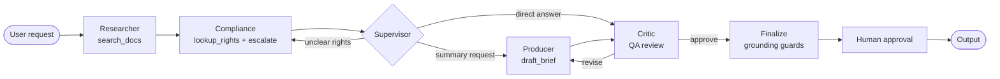

# Multi-Agent Production Workflow & MCP Server (`agents/`)

## Overview

Automates media rights research, compliance validation, and production brief drafting with deterministic grounding guards, Model Context Protocol (MCP) tool orchestration, and human-in-the-loop approval gates.

## Architecture



- `agent_v1.py`: Single LangGraph ReAct agent with deterministic post-processing guards
- `graph.py`: LangGraph supervisor + ReAct sub-agents per role (`role_agents.py`) with SQLite checkpoint pause/resume
- `workflow.py`: Shared grounding guards, auto-escalation, and `AgentResult` pipeline
- `stores/clearance_rows.py`: Authoritative `clearance_territories` SQL lookup paired with `pgvector`
- `mcp_server/server.py`: Model Context Protocol (MCP) server exposing 6 tools, 2 resources, and 4 workflow prompts over `stdio` and `SSE` (see [docs/mcp-enterprise.md](../docs/mcp-enterprise.md))

## Commands

```bash
cd applied-ai-platform
source .venv/bin/activate

# Start pgvector and ingest corpus
docker compose up -d
python rag/ingest_pgvector.py

# Single ReAct agent with tools
python agents/agent_v1.py \
  "Prepare clearance summary for Harbor Line S01E04 EMEA launch"

# Skip human approval prompt (CLI automation)
python agents/agent_v1.py --auto-approve "EMEA theme song clearance?"

# Agent scenario evaluation harness (7 gold scenarios)
python agents/evals/run_agent_eval.py
python agents/evals/run_agent_eval.py --graph   # Supervisor graph backend
python agents/evals/run_agent_eval.py --mcp     # MCP tools backend
python agents/evals/run_agent_eval.py --id japan_pending --verbose

# Multi-agent supervisor graph (InMemorySaver default; SQLite for pause/resume)
python agents/graph.py \
  "Prepare clearance summary for Harbor Line S01E04 EMEA launch"
python agents/graph.py --auto-approve "LATAM cleared?"
python agents/graph.py --checkpoint sqlite

# Checkpoint pause -> resume walkthrough
python agents/checkpoint_resume.py full

# MCP server (stdio for local MCP clients; SSE for HTTP clients)
python agents/mcp_server/server.py --smoke-test
python agents/mcp_server/client_demo.py
python agents/mcp_server/server.py --transport sse --port 8765
python agents/mcp_server/client_demo.py --sse http://127.0.0.1:8765/sse

# ReAct agent consuming tools over MCP (langchain-mcp-adapters)
python agents/agent_v1_via_mcp.py \
  "Prepare clearance summary for Harbor Line S01E04 EMEA launch"
```

## Tools (`tools.py` & `mcp_server/server.py`)

| Tool | Backend |
|------|---------|
| `search_docs` | `pgvector` RAG (`query_pgvector.py`), Chroma fallback |
| `lookup_rights` | Authoritative SQL `clearance_territories` + `pgvector` filtered search |
| `draft_brief` | Grounded LLM synthesis via `shared/llm` (Ollama or OpenAI) |
| `escalate_legal` | Structured compliance escalation when confidence < 0.7 |
| `check_ip_flags` | Scans sponsorship and product-placement restrictions |

Deterministic post-processing guards (`workflow.py`):
- **Auto-escalate:** Triggers `escalate_legal` whenever `lookup_rights` confidence < 0.7
- **Clearance grounding guard:** Prevents the LLM from contradicting authoritative SQL territory status
- **Auto-draft:** Ensures `draft_brief` runs on production brief requests even with smaller local models

## Key files

| File | Purpose |
|------|---------|
| `tools.py` | Core LangChain tools + SQL/`pgvector` clearance lookup |
| `workflow.py` | Deterministic grounding guards, `AgentResult`, post-processing pipeline |
| `role_agents.py` | ReAct sub-agents + Critic reviewer for Researcher, Compliance, and Producer |
| `agent_v1.py` | Single ReAct agent CLI |
| `agent_v1_via_mcp.py` | ReAct agent loading tools dynamically via MCP (`langchain-mcp-adapters`) |
| `graph.py` | LangGraph supervisor `StateGraph` with optional SQLite checkpointer |
| `checkpoint_resume.py` | Human-in-the-loop pause and resume walkthrough |
| `mcp_server/server.py` | MCP server exposing tools, resources, and prompts over `stdio` and `SSE` |
| `mcp_server/client_demo.py` | CLI MCP client demo |
