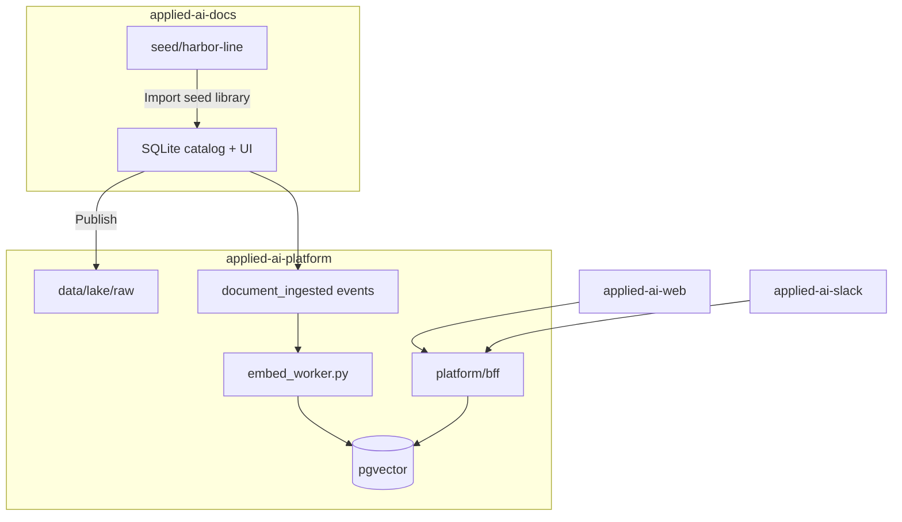

# Document corpus sources of truth

## Ownership

| Layer | Repository | Role |
|-------|------------|------|
| **Authoring & catalog** | [applied-ai-docs](https://github.com/bernardovchevez/applied-ai-docs) | Libraries, metadata, markdown bodies, publish workflow |
| **Bronze landing** | `applied-ai-platform/data/lake/raw/` | Files + `sharepoint-meta.json` written on **Publish** from docs |
| **Vector index & AI** | `applied-ai-platform` | pgvector, BFF RAG/agents, evals, MCP tools |

Slack and web clients talk only to the **platform BFF**. They do not read the docs catalog directly.

## Golden path



Dev-only shortcut (no docs UI): `ingest_batch.py --seed-from-library` copies seed into `lake/raw`, then batch manifest/events. Prefer **Import → Publish** so the catalog stays source of truth.

## Localhost workflow

1. Run **applied-ai-docs** (`./run.sh` on port 8010).
2. Create or edit documents in the UI (or **Import seed library** once).
3. **Publish** (per item or all pending) → lake raw + `document_ingested` events.
4. Run **`python platform/pipelines/embed_worker.py`** (or enable `RUN_EMBED_WORKER` in docs).
5. Query via BFF, Slack, or web.

## Seed pack (`applied-ai-docs/seed/harbor-line/`)

Harbor Line bootstrap markdown lives in the **docs repo**, not here. Use docs **Import seed library** or:

```bash
cd applied-ai-docs && ./run.sh
# UI: Import seed library → Publish all pending → embed worker
```

Dev fallback copy seed → lake (requires sibling docs repo):

```bash
python platform/pipelines/ingest_batch.py --seed-from-library --emit-events
python platform/pipelines/embed_worker.py
```

## Defaults

- `shared.config.DATA_DIR` → `data/lake/raw` (published corpus).
- `ingest_batch.py` does **not** copy the seed pack unless `--seed-from-library` is passed (`--seed-from-synthetic` is a deprecated alias).

See also [data-plane.md](data-plane.md).
